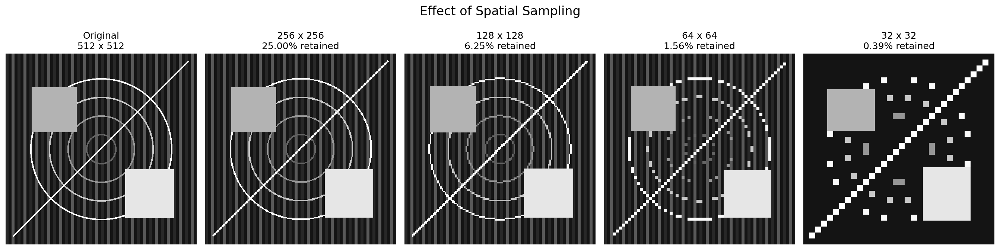
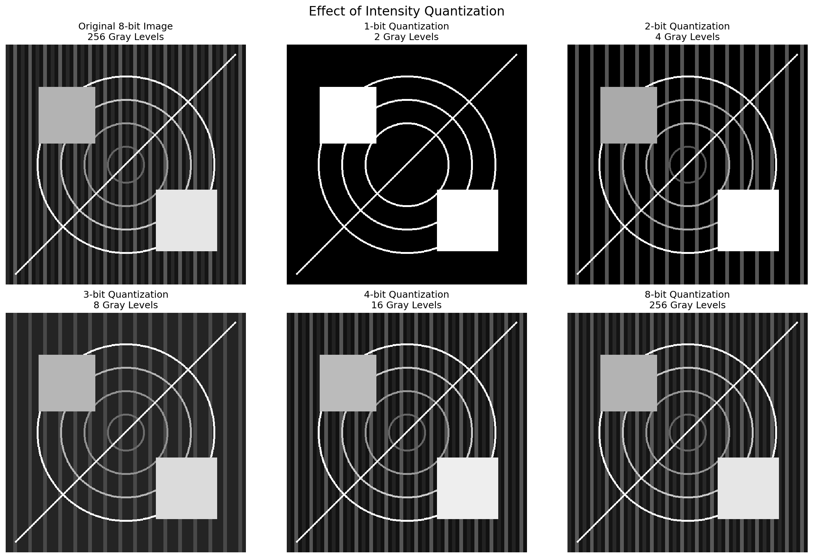
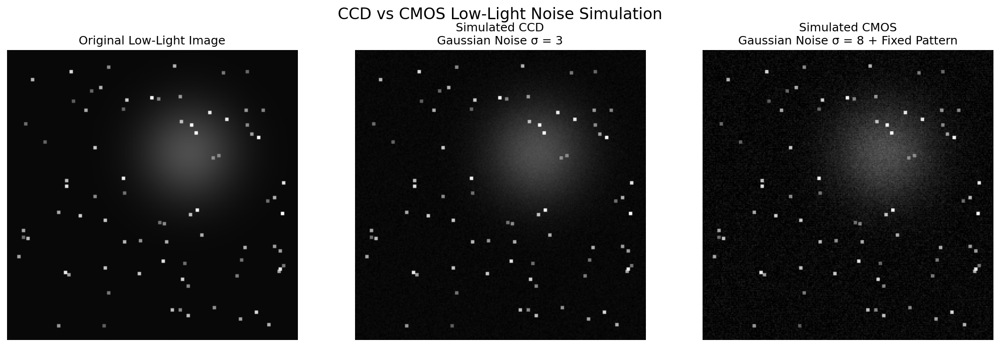

# Digital Image Processing Fundamentals

**17 Python experiments connecting image formation, sensor reconstruction, sampling, quantization, and noise simulation.**

An educational project using NumPy, Pandas, Matplotlib, and Pillow. The notebook contains explanations, code, computed results, and plots. All 22 required input files are included in `data/`.

[Open the notebook](digital_image_processing_fundamentals_project.ipynb)

## Visual results

### Spatial sampling


Reducing a 512 × 512 image to 32 × 32 retains only 0.39% of its samples. Nearest-neighbor enlargement restores the dimensions but not the original detail.

### Intensity quantization


Spatial dimensions stay fixed while available intensity levels change from 2 to 256.

### Simulated low-light noise


These are illustrative noise assumptions, not measurements of commercial CCD or CMOS devices.

## Selected numerical results

Results below were computed from the supplied synthetic datasets. MSE is measured in squared grayscale levels.

| Experiment | Result |
|---|---:|
| 256 × 256 downsampling, enlarged back to 512 × 512 | MSE 448.63 |
| 32 × 32 downsampling, enlarged back to 512 × 512 | MSE 3974.38 |
| 1-bit quantization | MSE 2700.59 |
| 4-bit quantization | MSE 24.01 |
| 8-bit quantization | MSE 0.00 |
| Missing line reconstructed by interpolation | MAE 4.40; MSE 35.10 |
| 1000 × 1000 ROI compared with 4000 × 4000 frame | 93.75% fewer pixels processed |

## Experiments

1. Electromagnetic wavelength and frequency
2. Photon energy
3. Visible-spectrum classification
4. Weighted RGB grayscale conversion
5. Radiant/luminous flux and subjective brightness
6. Grayscale intensity statistics
7. Signed Doppler velocity fields
8. Single-element sensor reconstruction
9. Line-sensor reconstruction and missing-line interpolation
10. 2D sensor arrays and thresholding
11. 3D sensor volumes and cross-sections
12. Spatial sampling and reconstruction error
13. Intensity quantization and theoretical storage
14. DPI, image dimensions, and raw storage
15. Line-pair resolution and conservative sampling density
16. Simplified CCD/CMOS power and battery runtime
17. Low-light noise, signal-to-noise ratio, and ROI processing

## Run locally

Extract or clone the whole project. Open a terminal in the folder containing this README, the notebook, and `data/`.

```bash
python -m pip install -r requirements.txt
python -m pip install jupyterlab
python -m jupyterlab
```

Open `digital_image_processing_fundamentals_project.ipynb`, restart the kernel, then run all cells from top to bottom. Keep the `data/` folder beside the notebook. The dependency list pins the analysis library versions used during verification; JupyterLab is installed separately as the notebook interface.

## Files

| Path | Contents |
|---|---|
| `digital_image_processing_fundamentals_project.ipynb` | Main notebook with saved results |
| `data/` | Original synthetic input data and supporting reference images |
| `images/` | Three exported result figures used in this README |
| `requirements.txt` | Verified analysis library versions |
| `.gitignore` | Excludes virtual environments and notebook checkpoints |

## Data provenance and limitations

The supplied `data/README.txt` identifies these resources as **Lecture 3 Python Lab Resources**, with synthetic files created for educational use. The original data and its README are preserved unchanged. The supplied materials do not identify a named creator or an explicit redistribution license; no new license is asserted for them here.

- The legacy file `radiance_luminance.csv` uses watts and lumens. The analysis interprets those units as radiant and luminous flux, while retaining the source column names.
- Weighted RGB grayscale conversion is a luma approximation, not calibrated physical luminance.
- The line-pair experiment uses a conservative four pixels per pair. It distinguishes this from the theoretical Nyquist boundary of two pixels per pair.
- The quantization storage calculation is theoretical bit-packed raw storage. Display arrays remain `uint8`; the experiment does not write compressed low-bit-depth image files.
- The CCD/CMOS parameters are simplified teaching assumptions; they do not establish universal hardware rankings.
- SNR uses mean signal divided by injected noise standard deviation before clipping, expressed as a linear ratio.
- The ROI benchmark times NumPy mean and standard deviation on an image and cropped view already in memory. It does not measure camera readout, and timing depends on the machine.

## Verification

All 17 code cells were executed in order in a shared Python namespace with the supplied inputs. Standard output and 54 Matplotlib figures were captured in the notebook. Three exported figures were visually reviewed. This validates sequential Python execution; the JupyterLab interface itself was not exercised in the verification environment.

Verified environment: Python 3.12.14; numpy 2.3.5, pandas 2.2.3, matplotlib 3.10.8, Pillow 12.3.0.
